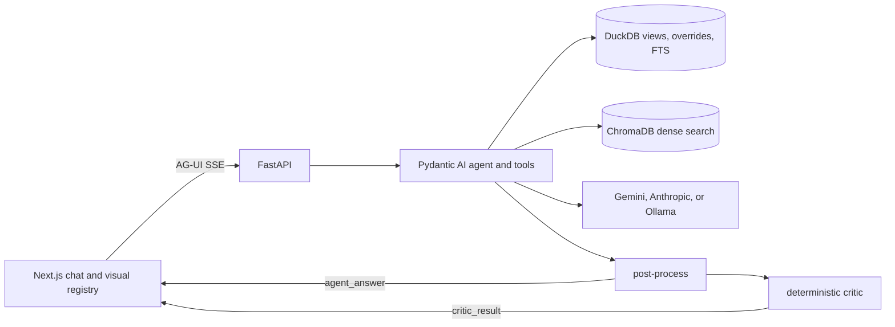

# Asset Intelligence Copilot: system design

The model chooses tools and writes the prose. DuckDB views and a deterministic resolver own the numbers and the well state.

## Architecture

FastAPI streams the agent over AG-UI. Post-processing merges citations from the answer and the tool evidence, rewrites informal well mentions to `WELL-NNNN`, fills the visual from the tool payload, and maps names such as "NE-8" to canonical area and team ids or reports them unresolved. The `agent_answer` event is sent first. The critic is a deterministic check, not a model call. It checks grounded numbers, citations, overrides, and the visual, emits `critic_result`, and does not retry.

## Storage

One DuckDB file holds the dataset, runtime memory, full-text search, and the views every tool reads. `v_effective_inspections` overlays overrides on raw readings. `v_is_producing` compares the temperature delta with the well-type threshold. `v_well_latest_inspection` keeps the latest reading per well. `v_corrected_spills` drops a spill only after a formal correction or an explicit override. `v_well_type_rules_effective` applies well-type overrides, including a changed RCA count. Overrides keep the original value, author, and reason. Source rows stay unchanged. Ingest skips malformed JSON, non-object JSONL lines, unknown foreign keys, and non-numeric readings, and it completed a corrupted-dataset rehearsal.

## Retrieval

Structured questions use SQL tools. Repair-report text uses `search_reports`: DuckDB BM25 plus ChromaDB dense search (`BAAI/bge-small-en-v1.5`), in about 400-token chunks with 50-token overlap. Reciprocal rank fusion (k=60) merges the lists and keeps one hit per maintenance report. Well, area, and date filters apply to both sides. SOPs and manuals are section lookups.

## Memory and feedback

Conversations are private: reads filter on `user_id`, and `recall_user_context` sees only the caller. Shared state is `context_notes` (`source='runtime'`), overrides at inspection, well, well-type, or global scope, and `shared_claims`. `record_feedback` writes an override, so a corrected reading changes that well for everyone and a well-type rule applies only to that type. `record_shared_note` writes a dated note under the author's name. `record_claim` always stores the claim as `unconfirmed` and reports whether it contradicts the data.

## Conflicts

`resolve_well_state` is deterministic. Order is the inspection temperature delta, then active context-note windows, then an inspector note that disagrees, then a stale recorded status, then unconfirmed claims. It returns state, reasons, and conflicts, so a correction can flip the state while the disagreeing note stays visible. For spills, a formal correction or a `spill_detected=false` override removes the detection. Informal notes never do, and a disagreement between them is reported.

## Models and cost

`backend/providers.py` selects Gemini, Anthropic, or local Ollama. Cloud calls fall back to Ollama on API errors, including rate limits and timeouts. The provider is swappable, and Ollama is the offline fallback. The live eval is on Ollama after Gemini free-tier 429s and exhausted Anthropic credits. Cost is one tool-calling turn per question. Aggregates stay in DuckDB.

## Next steps

On a failed critic check, retry the agent once. Add confirm and reject for claims. Write the per-user summary (`turn_summaries` is read and never written). Require approval before a shared override applies.
